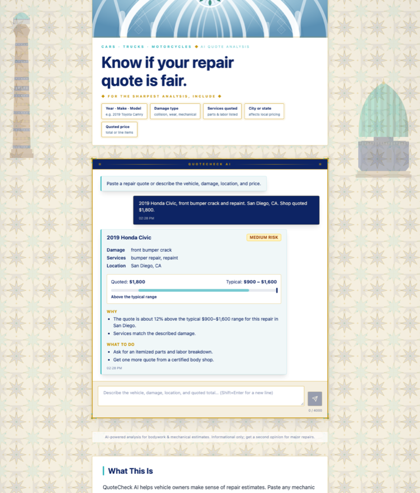

# QuoteCheck AI

[](https://github.com/Abdu5524-cpu/mechanic-chatbox/actions/workflows/ci.yml)

**Is your repair quote fair?** Paste a mechanic's estimate in plain language. Claude parses it, researches what that repair typically costs in your area with live web search, and returns a structured verdict: the typical price range, where your quote falls in it, a LOW / MEDIUM / HIGH risk rating, and concrete next steps.

**Live demo:** https://mechanic-frontend.onrender.com. It runs on Render's free tier, so the first request after an idle period can take about 30 seconds.



## How it works

```
Browser (Next.js static site)
  └─ POST /api/analyzeQuote { userText }
       Express API
         ├─ origin allow-list (403 before any work) → rate limit → input guardrails
         ├─ regex extraction: quoted total, currency, location hint
         └─ Claude (one call)
              ├─ web_search tool: researches typical local prices
              └─ submit_quote_analysis tool: returns the JSON contract
                   (retries once with the tool forced if search is unavailable)
       ← normalized analysis → result card with risk badge and price-range bar
```

## Engineering decisions

- **Structured output through forced tool use.** The response contract is a tool's `input_schema`, so the model returns typed JSON rather than prose that has to be parsed. The server also normalizes the result (range ordering, enum fallback, null-safe numbers) so the UI never has to handle malformed output.
- **One model call, grounded by search.** The model researches prices and fills in the schema in a single request. If web search is disabled or the model skips the tool, one retry forces the tool without search, so the user still gets an answer.
- **Deterministic code for facts stated in the text.** Regex pulls the quoted total and currency from the text and overrides the model's reading. A guard keeps a model year ("Quote for 2019 Civic") from being read as a price.
- **Quote text is treated as data.** User input is fenced in `<quote>` tags and the system prompt tells the model to ignore instructions inside it.
- **Spend protection.** Disallowed browser origins get a 403 before any LLM call. Rate limiting is per client IP (with `trust proxy` behind Render), and inputs are capped at 4,000 characters.
- **The API key stays on the server.** The frontend is a static export with no secrets, and only the backend holds `ANTHROPIC_API_KEY`.

## Tech stack

| Layer | Technology |
|---|---|
| Frontend | Next.js (static export), React 19, Tailwind CSS v4, Framer Motion |
| Backend | Node 22, Express 4, Anthropic SDK |
| AI | Claude (`claude-sonnet-5` by default) with the web search tool |
| Quality | Vitest, Supertest, ESLint, TypeScript, GitHub Actions |
| Hosting | Render (Web Service + Static Site) |

## Run locally

Prerequisites: Node 20+ and an Anthropic API key from https://console.anthropic.com/settings/keys (web search must be enabled for your org).

```bash
git clone https://github.com/Abdu5524-cpu/mechanic-chatbox.git
cd mechanic-chatbox

cp backend/.env.example backend/.env     # then set ANTHROPIC_API_KEY
cp frontend/.env.example frontend/.env   # points the UI at http://localhost:3000

cd backend && npm install && npm run dev      # API on :3000
cd ../frontend && npm install && npm run dev  # UI on :3001
```

Open http://localhost:3001.

## Tests

```bash
cd backend && npm test                     # API, security middleware, extractors, Claude client, parser
cd frontend && npm test && npm run lint && npm run typecheck
```

## API

`POST /api/analyzeQuote` with `{ "userText": "2019 Honda Civic, front bumper crack and repaint. San Diego, CA. Shop quoted $1,800." }`

```json
{
  "success": true,
  "parsed": {
    "parsedQuote": {
      "vehicle": { "make": "Honda", "model": "Civic", "year": "2019" },
      "damages": ["front bumper crack"],
      "location": { "city": "San Diego", "stateOrRegion": "CA" },
      "services": ["bumper repair", "repaint"],
      "quoteTotal": 1800,
      "currency": "USD",
      "quoteRangeMin": 900,
      "quoteRangeMax": 1600,
      "shopName": null,
      "notesFromUser": null
    },
    "riskLevel": "MEDIUM",
    "reasons": ["The quote is about 12% above the typical $900–$1,600 range for this repair in San Diego."],
    "recommendations": ["Ask for an itemized parts and labor breakdown.", "Get a second quote."]
  }
}
```

| Status | Meaning |
|---|---|
| 400 | `userText` missing, under 10 or over 4,000 characters, or the body is malformed |
| 403 | Browser origin not in `ALLOWED_ORIGINS` |
| 429 | Rate limit (20 requests / 15 min) |
| 502 | Analysis failed upstream (generic message; details are in the server logs) |

`GET /health` returns `{ "status": "ok" }`.

## Deployment (Render)

| Service | Settings |
|---|---|
| Backend: Web Service | Root `backend`, build `npm ci`, start `node app.js`, health check `/health`, env `ANTHROPIC_API_KEY`, `ALLOWED_ORIGINS` (frontend URL) |
| Frontend: Static Site | Root `frontend`, build `npm ci && npm run build`, publish `out`, env `NEXT_PUBLIC_API_BASE_URL` (backend URL) |

## License

MIT. See [LICENSE](LICENSE).
